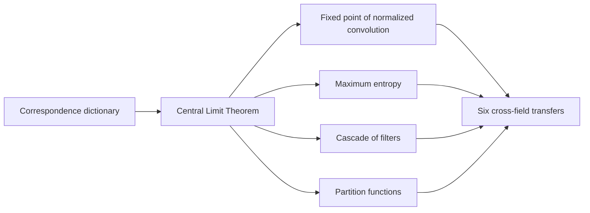

# Convolutions: The Big Picture

Paper by Anirudh Srinivasan and Mohd Suhail Rizvi, IIT Hyderabad: *Convolutions - The Big Picture: Unifying Probability, Signal Processing, Statistical Mechanics, and Information Theory*.

Convolutions appear in probability, signal processing, statistical mechanics and information theory. The paper argues that these are one underlying structure, so a non-trivial theorem in one field can be carried across a correspondence dictionary to another.

## Outline

- The Central Limit Theorem is proved two ways, with moment generating functions and with characteristic functions, and read as a fixed-point theorem, a maximum-entropy attractor and an equilibrium argument.
- Six cross-field transfers are carried through. Stein's lemma and Price's theorem are the same equation, the De Bruijn identity ties Gaussian filtering to the heat equation, the Entropy Power Inequality gives a noise floor for amplifier chains, the Fisher Information Inequality gives bandwidth irreversibility, Berry-Esseen gives a filter-design principle, and Cramér's large-deviations theorem gives the tail decay of cascaded filters.
- A final section treats Fourier, Laplace and moment generating transforms as one integral against an exponential kernel.

## Contents

| Path | Purpose |
| --- | --- |
| `docs/convolutions-the-big-picture.pdf` | The paper, 10 pages |
