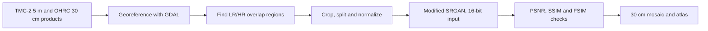

# ISRO Chandrayaan Moon Mapping

Inter IIT Tech Meet 11.0 problem statement from ISRO: generate very high resolution images of the Moon from low resolution TMC-2 (5 m) sensor data, using OHRC (30 cm) images as the target, and build a lunar atlas from the generated data.

The slide deck in [`docs/slides-team21.pdf`](docs/slides-team21.pdf) covers the approach below.

## Approach

- Data preparation: georeferenced the OHRC `.img` products, found the overlap with TMC-2 strips in QGIS and Python, cropped the overlap into train, validation and test sets, and normalized radiometry.
- Model: an SRGAN modified for satellite data. It takes 16-bit input, drops the max-pooling layer and pixel shuffle in the last layers to tolerate slight mis-registration, ends the generator with a ReLU so the task becomes regression, and clips gradients.
- Loss: a combination of mean gradient error, for edge sharpness, and mean squared error, for overall content.
- Evaluation: PSNR, SSIM and FSIM between ground truth and predicted data.

## Result

The team finished second overall among the IITs and won a silver medal. The deck notes the limits: few overlapping strips, short training because of resource limits, and some artifacts in the output.

## Contents

| Path | Purpose |
| --- | --- |
| `docs/slides-team21.pdf` | Problem statement presentation by Team 21 |
