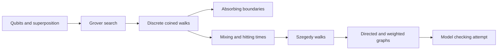

# Quantum Random Walks

Project at IIT Hyderabad, mentored by Dr. M.V. Panduranga Rao.

The project studies quantum random walks as the quantum counterpart of Markov chains. The slides build up from qubits and Grover's search to coined walks on a line and on regular graphs, absorbing boundaries, mixing and hitting times against their classical versions, Szegedy walks, and an attempt at walks on directed and weighted graphs and at simple model checking.

## Topics

- Coined walks: the state lives in a coin space tensored with a position space, and each step applies a coin operator and then a shift. Grover's diffusion coin is used for balanced walks on `d`-regular graphs.
- Boundaries: a measurement against an absorbing node after each step shows that a quantum walk can escape, where a classical walk is always absorbed.
- Speed-ups: mixing and hitting times are compared with classical walks on circles and hypercubes.
- Limits: the directed and weighted graph work and the model-checking idea were explored, but the slides note that the area is already well developed.

The notes in `docs/notes-quantum-dot-implementation.pdf` summarize a physical implementation of a quantum walk on an array of quantum dots.

## Contents

| Path | Purpose |
| --- | --- |
| `docs/slides-cs5150.pdf` | Project presentation, 42 slides |
| `docs/notes-quantum-dot-implementation.pdf` | Short notes on the quantum-dot framework for quantum walks |
